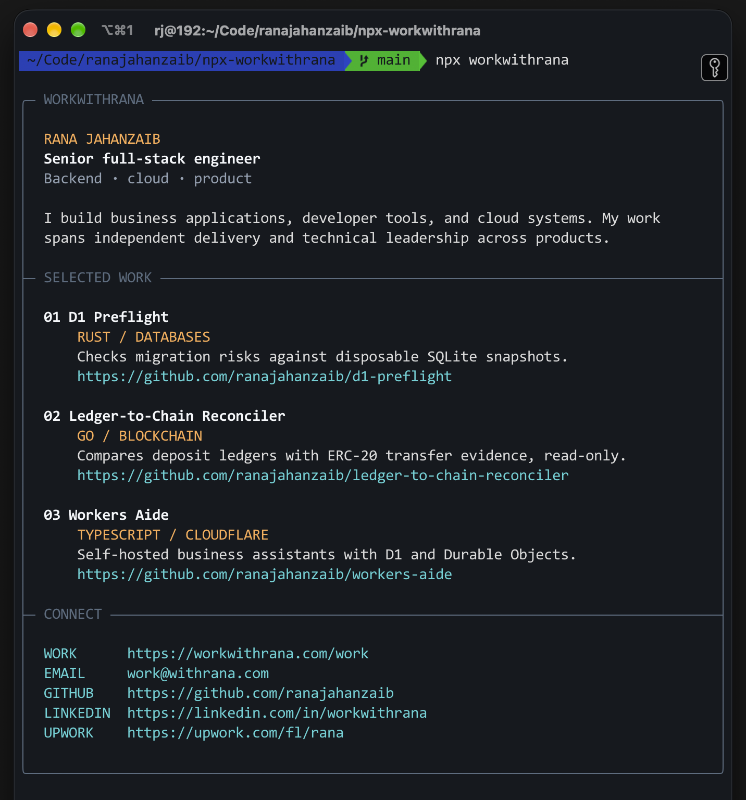

# workwithrana

A short terminal profile for Rana Jahanzaib, with selected public engineering projects and contact links.

```sh
npx workwithrana
```



The command prints a framed profile, three project links, and ways to get in touch. It adapts to narrow terminals, uses color when supported, and honors `NO_COLOR`. It also supports `--help` and `--version`. It has no runtime dependencies or network calls.

## Development

```sh
npm test
npm pack --dry-run
```

Project details and contact information should be reviewed against [workwithrana.com](https://workwithrana.com/) before each release.

## License

MIT. See [LICENSE](./LICENSE).
